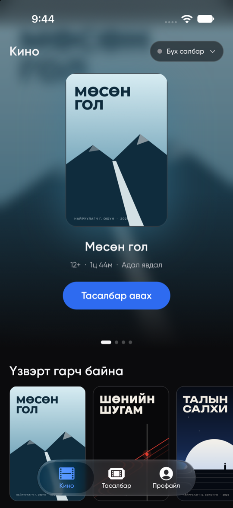
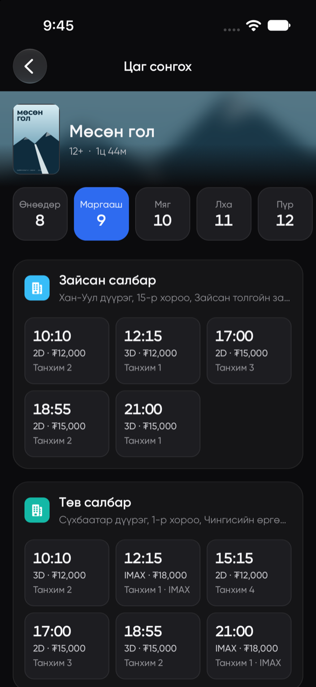
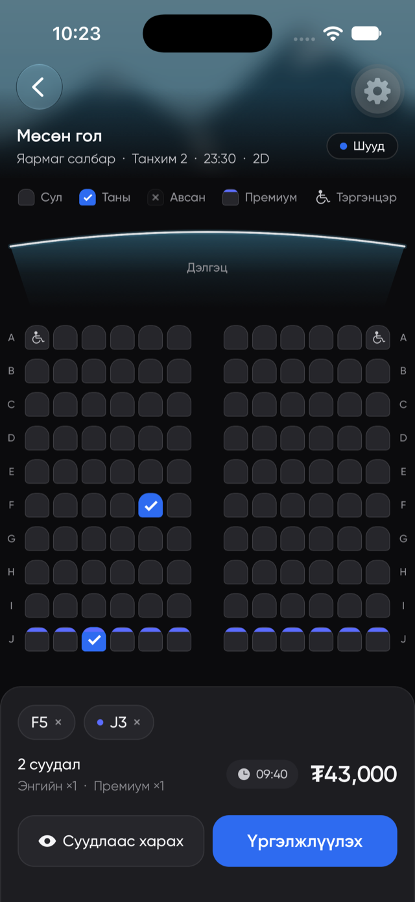

# Open Cinema

Open Cinema is an open-source cinema ticketing system built Mongolian-first: a customer app for
browsing films and booking seats, a web app for cinema admins and door staff, and the API behind
both. It runs with no external accounts, so you can clone it and have a working cinema in minutes.

Its signature feature is the **view from your seat**. Pick a seat on the live map and the hall tilts
into 3D, the camera flies to eye level, and a card tells you the real numbers: how far you are from
the screen, how much of your view it fills, and how far off-center you sit.



## Why you can trust a booking

- **A seat can be sold once.** One valid ticket per seat per showtime is a unique constraint in
  Postgres, not a check in application code. Concurrent buyers lose cleanly.
- **Holds are real.** Selecting seats holds them for 10 minutes; a hold is also a database row with a
  unique seat per showtime.
- **Pay twice, get one booking.** Booking creation is idempotent by key: a double tap or a retry
  returns the same booking and the same invoice.
- **Late payment is safe.** If a hold expired and someone else took the seat, the booking is marked
  failed, the payment is refunded and the app shows an explicit "seats lost" state.
- **Seats update live** through Server-Sent Events. A reconnecting client receives a full snapshot
  first, so stale colors never linger.
- **Ulaanbaatar time throughout.** Times are stored in UTC, and "which day is this showtime" and
  "is this ticket for today" are computed in `Asia/Ulaanbaatar`.

## Features

**Customer app** (Expo, iOS first, Android works)

- Browse films now showing and coming soon, by branch, with trailers and showtimes
- Live seat map with standard, premium and wheelchair seats
- 3D view from the selected seat with distance, screen coverage and angle
- Book as a guest, or log in with a one-time code by SMS (phone) or email
- QR ticket, Apple Wallet pass, add to calendar with a 30-minute reminder; loaded tickets stay readable offline
- Mongolian (default) and English

**Admin web** (Next.js, Mongolian)

- Branches, halls with seat geometry, films, showtimes and prices
- Sales reports
- Today's showtimes across branches with sold and admitted counts
- Scan history across branches: filter by branch, day and result, down to a single showtime
- Staff accounts per branch

**Staff web (PWA, same app)**

- Scan tickets from a phone browser: admitted, repeat, already used, wrong branch, wrong day
- Two-minute undo for a mistaken scan

**API** (Express + TypeScript)

- zod-validated requests, Drizzle ORM migrations, role checks on every route
- OTP rate limits, admin lockout, hashed refresh tokens with rotation
- Provider interfaces for messages (dev log or an optional SMS/email adapter), storage (local disk or an optional hosted adapter) and payments (mock only in v1: anyone can mark an order paid, so production refuses to start unless `ALLOW_MOCK_PAYMENTS=1`)

## Architecture

```
Expo app (customer) ──┐
                      ├──> Express API ──> PostgreSQL (any)
Next.js (admin+staff) ┘     (1 process)  │
                                         ├──> messages    dev log or optional adapter
                                         ├──> storage     local disk or optional adapter
                                         ├──> payment provider (mock today)
                                         └──> passkit-generator  Apple Wallet .pkpass (optional)
```

| Folder       | Contents                                                          |
| ------------ | ----------------------------------------------------------------- |
| `mobile-app/` | Customer app: Expo SDK 58, expo-router                            |
| `web-admin/` | Admin and staff web app: Next.js                                  |
| `backend/`   | API: Express, Drizzle, tests against a real Postgres              |
| `docs/`      | Design, deployment runbook, credentials guide, screenshots        |
| `.github/`   | CI workflow, gitleaks config                                      |

Each of `mobile-app/`, `backend/` and `web-admin/` is a standalone package: its own `package.json`,
`package-lock.json`, `node_modules`, `tsconfig.json`, `biome.json` and `.env`. The zod schemas, types
and seat/3D math that all three use live in `backend/src/shared/` and are copied unchanged to
`mobile-app/src/shared/` and `web-admin/lib/shared/`. Edit the backend copy, then run `npm run sync:shared`
at the repository root; CI fails (`npm run check:shared`) when the copies differ.

## Quick start

You need Node 24 and a local Postgres 17.

```bash
git clone https://github.com/roaziy/open-cinema-mn.git
cd open-cinema-mn
npm run install:all             # npm ci in backend/, web-admin/ and mobile-app/

createdb open_cinema_dev
createdb open_cinema_test

cd backend
cp .env.example .env            # defaults work locally: codes are logged, files stay on disk
npm run db:migrate
npm run db:seed                 # fictional cinemas, films and an admin account (see backend/.env)

npm run dev                     # API on http://localhost:4000 (from the repo root: npm run dev:backend)
curl http://localhost:4000/v1/health
```

Login codes are printed in the API log while `MESSAGES_PROVIDER=dev`.

**Customer app** on the iOS simulator (development build, not Expo Go):

```bash
cd mobile-app
cp .env.example .env
npx expo run:ios
```

A physical phone on the same Wi-Fi works without editing `mobile-app/.env`: in development the app replaces `localhost` in `EXPO_PUBLIC_API_URL` with the Metro host's LAN address (the API listens on all interfaces). On iOS, allow "Local Network" access when prompted. Fonts are also loaded at runtime, so Expo Go shows the brand font too.

**Admin web:**

```bash
cd web-admin
cp .env.example .env
npm run dev                       # http://localhost:3000 (from the repo root: npm run dev:admin)
```

Sign in with `SEED_ADMIN_EMAIL` / `SEED_ADMIN_PASSWORD` from `backend/.env` (development only). On a real deployment create the first admin with `npm run admin:create:prod` in `backend/`; see [`docs/deploy.md`](docs/deploy.md).

**Checks**, in each of `backend/`, `web-admin/` and `mobile-app/`:

```bash
npm run typecheck && npm run lint && npm test
```

Backend tests need `TEST_DATABASE_URL` (see `backend/.env.example`) and run against real Postgres.
After editing `backend/src/shared/`, run `npm run sync:shared` at the repository root.

## Screenshots

| Home                               | Showtimes                                    | Seat map                                  | Admin                                |
| ---------------------------------- | -------------------------------------------- | ----------------------------------------- | ------------------------------------ |
|  |  |  |  |

The images live in [`docs/screenshots/`](docs/screenshots/).

## Self-hosting

Open Cinema needs a Node 24 host for the API (one process), any PostgreSQL the API can reach, and a
host that runs Next.js for the admin web. Every external service (file storage, login-code messages,
Apple Wallet) is optional.

- [`docs/deploy.md`](docs/deploy.md): how to run each part (build, migrate, a pm2 and reverse proxy
  example that is safe for Server-Sent Events, updates, rollback, backups)
- [`docs/credentials.md`](docs/credentials.md): app secrets and the optional services, with how to
  verify and rotate them
- [`docs/design.md`](docs/design.md): product and architecture design

## License

[MIT](LICENSE)
