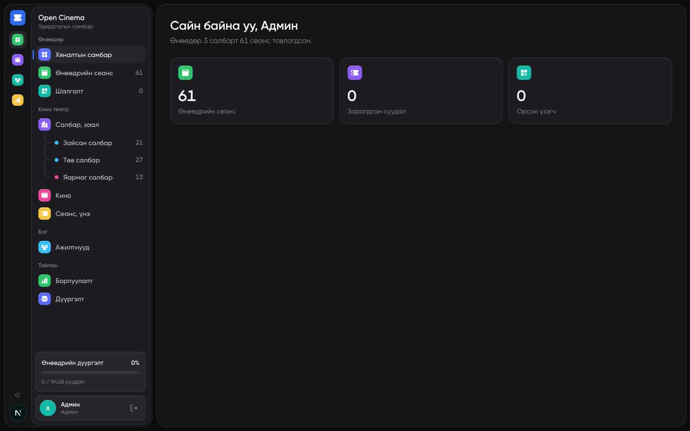

# Open Cinema

Open Cinema is an open-source cinema ticketing system built Mongolian-first: a customer app for
browsing films and booking seats, a web app for cinema admins and door staff, and the API behind
both. It runs with no external accounts, so you can clone it and have a working cinema in minutes.

Its signature feature is the **view from your seat**. Pick a seat on the live map and the hall tilts
into 3D, the camera flies to eye level, and a card tells you the real numbers: how far you are from
the screen, how much of your view it fills, and how far off-center you sit.


## Why you can trust a booking

- **A seat can be sold once.** One valid ticket per seat per showtime is a unique constraint in
  Postgres, not a check in application code. Concurrent buyers lose cleanly.
- **Holds are real.** Selecting seats holds them for 10 minutes; a hold is also a database row with a
  unique seat per showtime.
- **Pay twice, get one booking.** Booking creation is idempotent by key: a double tap or a retry
  returns the same booking and the same invoice.
- **Late payment is safe.** If a hold expired and someone else took the seat, the booking is marked
  failed, the payment is refunded and the app shows an explicit "seats lost" state.
- **Seats update live** through Server-Sent Events. A reconnecting client receives a full snapshot
  first, so stale colors never linger.
- **Ulaanbaatar time throughout.** Times are stored in UTC, and "which day is this showtime" and
  "is this ticket for today" are computed in `Asia/Ulaanbaatar`.

## Features

**Customer app** (Expo, iOS first, Android works)

- Browse films now showing and coming soon, by branch, with trailers and showtimes
- Live seat map with standard, premium and wheelchair seats
- 3D view from the selected seat with distance, screen coverage and angle
- Book as a guest, or log in with a one-time code by SMS (phone) or email
- QR ticket, Apple Wallet pass, add to calendar with a 30-minute reminder
- Mongolian (default) and English

**Admin web** (Next.js, Mongolian)

- Branches, halls with seat geometry, films, showtimes and prices
- Sales reports
- Today's showtimes across branches with sold and admitted counts
- Scan history across branches: filter by branch, day and result, down to a single showtime
- Staff accounts per branch

**Staff web (PWA, same app)**

- Scan tickets from a phone browser: admitted, repeat, already used, wrong branch, wrong day
- Two-minute undo for a mistaken scan

**API** (Express + TypeScript)

- zod-validated requests, Drizzle ORM migrations, role checks on every route
- OTP rate limits, admin lockout, hashed refresh tokens with rotation
- Provider interfaces for messages (wesend.mn), storage (local or Supabase) and payments (mock only in v1: anyone can mark an order paid, so production refuses to start unless `ALLOW_MOCK_PAYMENTS=1`)

## Architecture

```
Expo app (customer) ──┐
                      ├──> Express API ──> PostgreSQL (Supabase)
Next.js (admin+staff) ┘     (pm2)   │
        on Vercel                   ├──> wesend.mn   SMS + email
                                    ├──> payment provider (mock today)
                                    └──> passkit-generator  Apple Wallet .pkpass
```

| Folder       | Contents                                              |
| ------------ | ----------------------------------------------------- |
| `app/`       | Customer app: Expo SDK 58, expo-router                |
| `web-admin/` | Admin and staff web app: Next.js                      |
| `backend/`   | API: Express, Drizzle, tests against a real Postgres  |
| `shared/`    | zod schemas, types and seat/3D math used by all three |
| `deploy/`    | Production runbook                                    |
| `docs/`      | Design, credentials guide, screenshots                |

## Quick start

You need Node 24 and a local Postgres 17.

```bash
git clone https://github.com/<owner>/open-cinema-mn.git
cd open-cinema-mn
npm ci

createdb open_cinema_dev
createdb open_cinema_test

cp .env.example .env            # defaults work locally: codes are logged, files stay on disk
npm run db:migrate
npm run db:seed                 # fictional cinemas, films and an admin account (see .env)

npm -w @open-cinema/backend run dev        # API on http://localhost:4000
curl http://localhost:4000/v1/health
```

Login codes are printed in the API log while `MESSAGES_PROVIDER=dev`.

**Customer app** on the iOS simulator (development build, not Expo Go):

```bash
cd app
npx expo run:ios
```

**Admin web:**

```bash
npm -w web-admin run dev          # http://localhost:3000
```

Sign in with `SEED_ADMIN_EMAIL` / `SEED_ADMIN_PASSWORD` from your `.env` (created by `npm run db:seed`, development only). On a real deployment create the first admin with `npm -w @open-cinema/backend run admin:create:prod`; see [`deploy/README.md`](deploy/README.md).

**Checks**

```bash
npm run typecheck && npm run lint && npm test
```

Tests need `TEST_DATABASE_URL` (see `.env.example`) and run against real Postgres.

## Screenshots

| Home                               | Showtimes                                    | Seat map                                  | Admin                                |
| ---------------------------------- | -------------------------------------------- | ----------------------------------------- | ------------------------------------ |
|  |  |  |  |

The images live in [`docs/screenshots/`](docs/screenshots/).

## Self-hosting

Open Cinema needs a Node 24 host for the API (managed with pm2, no Docker), a Postgres database
(Supabase works well, and nothing runs on the API host), and Vercel or any Node host for the admin web.

- [`deploy/README.md`](deploy/README.md): step-by-step runbook (build, migrate, pm2, reverse proxy for
  Server-Sent Events, updates and rollback, admin web on Vercel)
- [`docs/credentials.md`](docs/credentials.md): every credential, where it goes, how to get it, how to
  verify and rotate it
- [`docs/design.md`](docs/design.md): product and architecture design

## License

[MIT](LICENSE)
